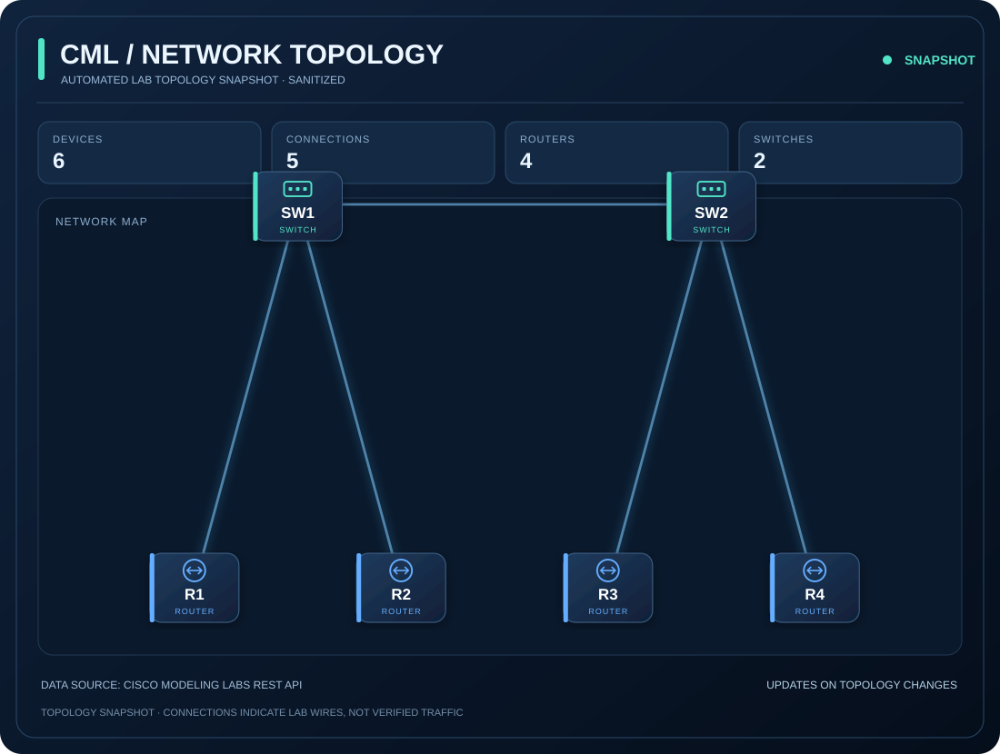
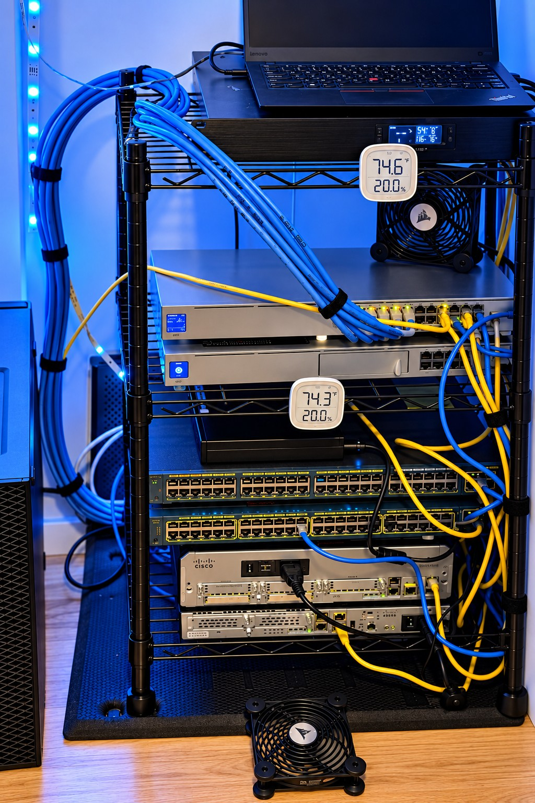

# CML Server Status

**🟢 UP**

Probe: `LENOVO1`

## Infrastructure Health

| Check | Result |
|---|---|
| VMware host ping | ✅ |
| CML VM ping | ✅ |
| CML API login | ✅ |

## Aggregate Lab Statistics

- Total labs: 165
- Running labs: 1
- Stopped labs: 164
- Partial labs: 0
- Total nodes: 869

_Checked locally every 15 minutes. Published only when infrastructure status or aggregate lab statistics change._

## Sanitized Topology Preview

_Last qualifying topology snapshot; not necessarily the current running lab._

## Recent Topology Snapshots

_Last three distinct sanitized topology snapshots; these are not necessarily three different labs._

| Captured (UTC) | Devices | Links | Routers | Switches |
|---|---:|---:|---:|---:|
| 2026-10-23 17:51 UTC | 4 | 3 | 3 | 1 |
| 2026-10-23 06:06 UTC | 6 | 5 | 4 | 2 |
| 2026-10-23 05:36 UTC | 5 | 4 | 4 | 1 |

## Physical Home Lab

_Physical networking equipment and server environment supporting my hands-on lab work._

