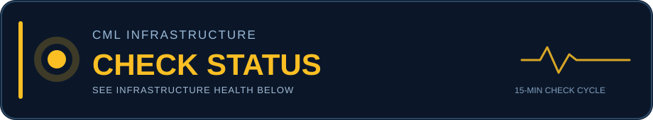
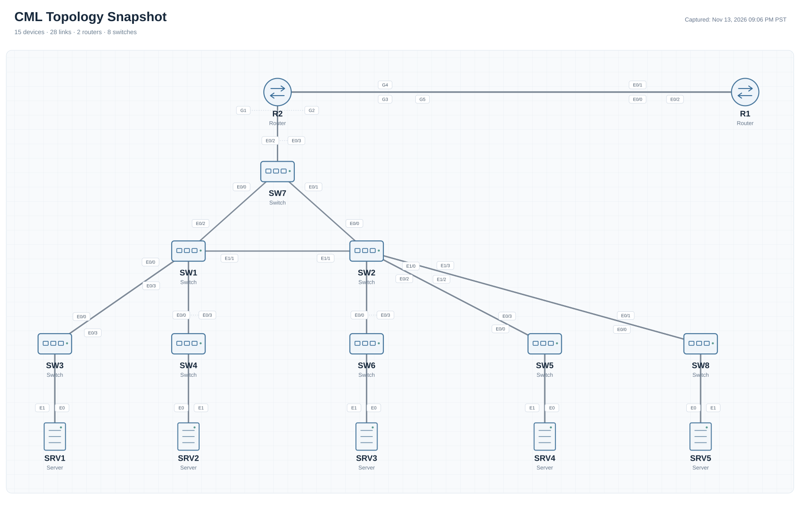
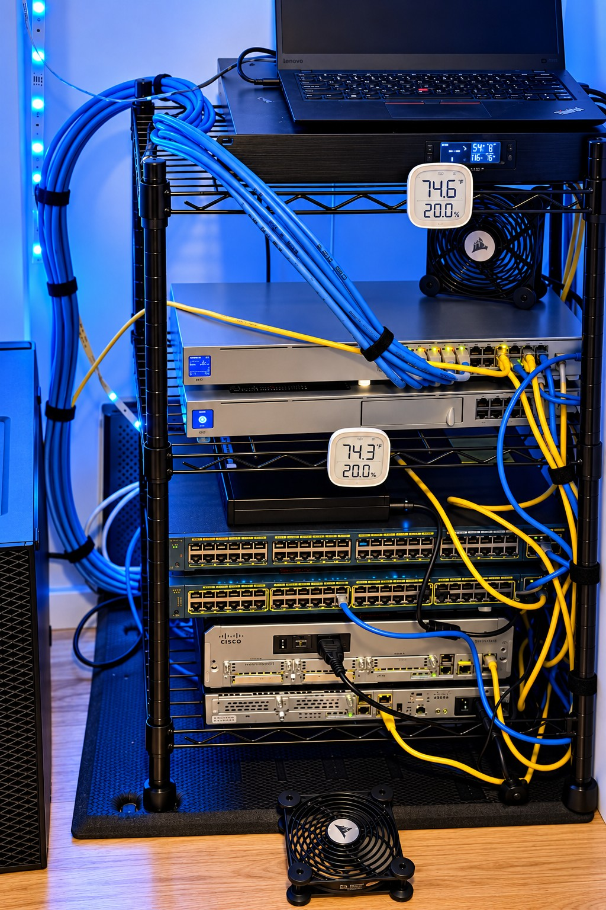

# CML Server Status

**🟢 UP**

Probe: `LENOVO1`

## Monitor Activity

_Local checks run every 15 minutes; this is the last published sample, not a live stream._

_Last published update (Pacific): 2026-11-11 03:06 AM PST_

## Infrastructure Health

| Check | Result |
|---|---|
| VMware host ping | ✅ |
| CML VM ping | ✅ |
| CML API login | ✅ |

## Aggregate Lab Statistics

- Total labs: 177
- Running labs: 0
- Stopped labs: 177
- Partial labs: 0
- Total nodes: 925

_Checked locally every 15 minutes. Published only when infrastructure status or aggregate lab statistics change._

## Network Topology

_Last qualifying topology snapshot; not necessarily the current running lab._

## Recent Topology Snapshots

_Last five distinct topology snapshots; these are not necessarily three different labs._

| Captured (Pacific) | Devices | Links | Routers | Switches |
|---|---:|---:|---:|---:|
| 2026-11-09 04:36 PM PST | 13 | 22 | 2 | 7 |
| 2026-11-09 04:06 PM PST | 12 | 21 | 1 | 7 |
| 2026-11-09 03:51 PM PST | 12 | 21 | 1 | 7 |
| 2026-11-08 01:56 PM PST | 11 | 15 | 1 | 6 |
| 2026-11-08 01:33 PM PST | 11 | 15 | 1 | 6 |

## Physical Home Lab

_Physical networking equipment and server environment supporting my hands-on lab work._

