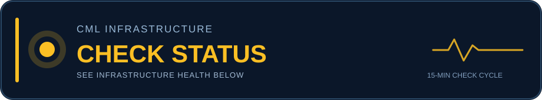

# CML Server Status

**🟢 UP**

Probe: `LENOVO1`

## Monitor Activity

_Local checks run every 15 minutes; this is the last published sample, not a live stream._

_Last published update (Pacific): 2026-10-27 05:21 PM PDT_

## Infrastructure Health

| Check | Result |
|---|---|
| VMware host ping | ✅ |
| CML VM ping | ✅ |
| CML API login | ✅ |

## Aggregate Lab Statistics

- Total labs: 171
- Running labs: 1
- Stopped labs: 170
- Partial labs: 0
- Total nodes: 890

_Checked locally every 15 minutes. Published only when infrastructure status or aggregate lab statistics change._

## Network Topology

_Last qualifying topology snapshot; not necessarily the current running lab._

## Recent Topology Snapshots

_Last five distinct topology snapshots; these are not necessarily three different labs._

| Captured (Pacific) | Devices | Links | Routers | Switches |
|---|---:|---:|---:|---:|
| 2026-10-27 05:21 PM PDT | 3 | 4 | 0 | 3 |
| 2026-10-27 04:51 PM PDT | 3 | 3 | 0 | 3 |
| 2026-10-27 04:36 PM PDT | 6 | 5 | 4 | 2 |
| 2026-10-25 11:36 PM PDT | 3 | 2 | 3 | 0 |
| 2026-10-25 03:36 PM PDT | 4 | 3 | 3 | 1 |

## Physical Home Lab

_Physical networking equipment and server environment supporting my hands-on lab work._

